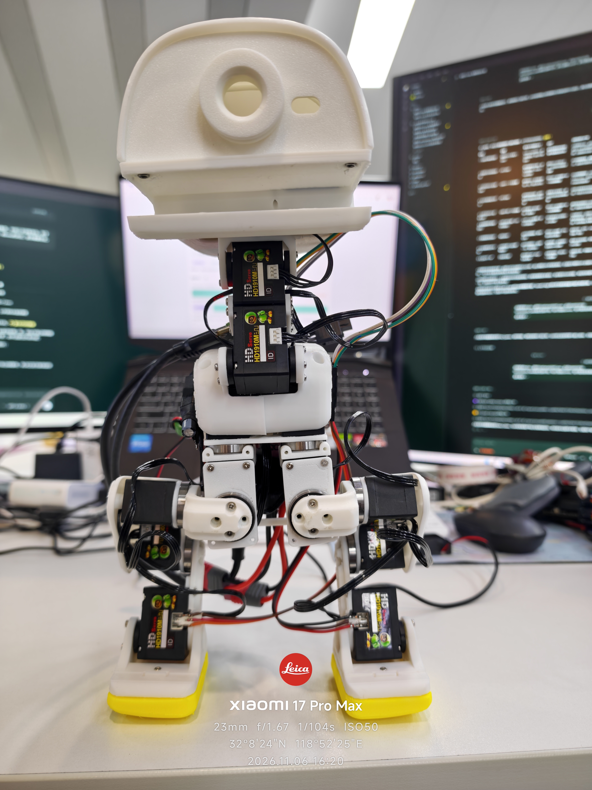
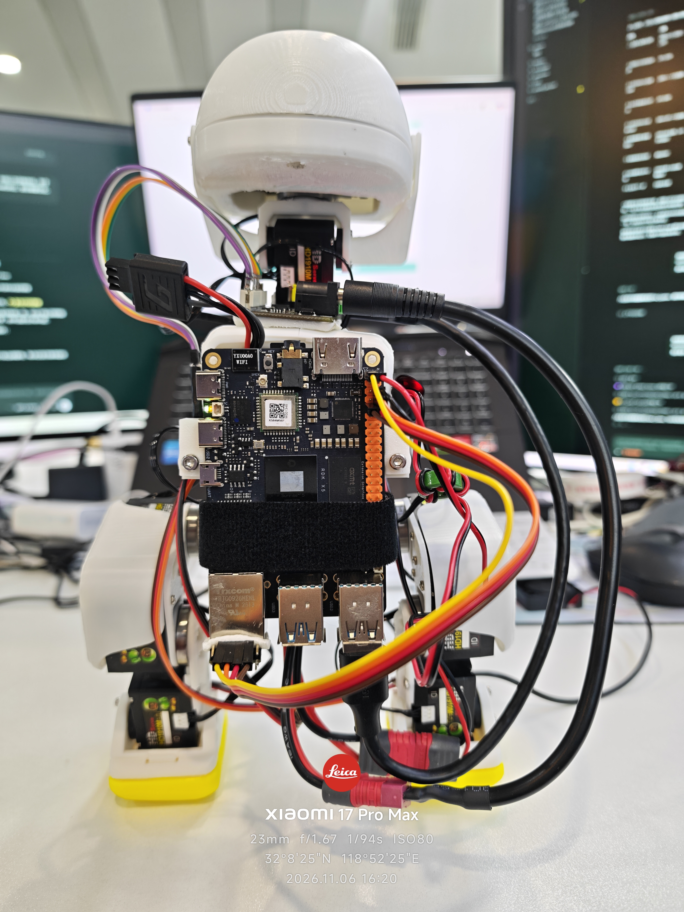

# RDK X5 Duck｜从零搭建一台机载机器鸭

## 微信交流群 · Duck Together 机器鸭共建群

**交流群已达200人，已移除置顶邀请二维码。希望进群交流的朋友，请联系我（[CanNyCat17](https://github.com/CanNyCat17)），由我邀请进群。** 可通过[仓库Issue](https://github.com/CanNyCat17/rdk-x5-microduck/issues)或[地瓜社区原帖](https://forum.d-robotics.cc/t/topic/35728/1)联系。

| 当前样机正面 | 当前样机背面 |
|---|---|
|  |  |

**一套围绕RDK X5开发板展开的开源机器人案例：硬件采购、3D打印、装配接线、软件部署、仿真环境和实机调试，按复刻顺序完整公开。**

**当前进度｜2026-11-06：上一版2S航模电池＋5V UBEC供电方案验证成功。** 行走稳定性仍在调试，现等待新采购的Hub分线板和线束到货。本次更新样机照片、下一版硬件BOM和进度计划，暂不更新行走视频。

**[最新进度与实拍](progress/2026-11-06/README.md) · [下一版硬件BOM](docs/NEXT_HARDWARE_BOM.md) · [当前样机](docs/CURRENT_PROTOTYPE.md) · [24章复刻手册](docs/FULL_SOLUTION.md) · [项目计划](ROADMAP.md)**

## 版本与实机证据

| 版本 | 已有结果 | 下一步 |
|---|---|---|
| **当前单电源布局** | X5、电池、微雪全部机载；2S航模电池＋5V UBEC方案验证成功 | 等待Hub和线束到货，继续行走稳定性验证 |
| **10月23日双电池样机** | 已实现机载短距离前进，保留完整录像和成功参数 | 作为单电源与后续步态的历史对照 |
| **长距离与RL闭环** | 仿真、适配与离线准备持续推进 | 仍需当前装载下的实机验证 |

<details>
<summary>查看已验证的双电池短距离前进视频与冻结版本</summary>

[](media/20261023/onboard-short-walk.mp4)

[实拍与成功参数](progress/2026-10-23/README.md) · [固定Release v2026.10.27.1](https://github.com/CanNyCat17/rdk-x5-microduck/releases/tag/v2026.10.27.1)

固定版本保留原运行包、R8A制造文件及双电池成功基线。`main`继续更新单电源文档和进展；当前单电源布局不能借用这段视频作为带载行走验收。

</details>

## 选一个入口开始

| 你想做什么 | 从这里开始 | 你会得到什么 |
|---|---|---|
| 先看方案与成果 | [完整案例](docs/FULL_SOLUTION.md) / [当前单电源样机](docs/CURRENT_PROTOTYPE.md) / [双电池成功配置卡](docs/PROTOTYPE_CONFIGURATION.md) | 看懂系统架构、实际装载、成果与后续路线 |
| 没有硬件，先体验 | [软件DEMO](DEPLOYMENT.md) / [MuJoCo仿真](SIMULATION.md) | 控制台流程体验、FT模型与小幅关节仿真 |
| 从零购买、打印、复刻 | [采购清单](docs/PROCUREMENT.md) → [装配检查表](docs/BUILD_CHECKLIST.md) → [首次运行](docs/FIRST_RUN.md) | 从零件到自己的START与首次动作 |
| 已有FT鸭子，接入X5 | [硬件与接线](HARDWARE.md) → [部署](DEPLOYMENT.md) | 确认设备差异后接入公开D运行包 |
| 改结构、软件或策略 | [参与开发](CONTRIBUTING.md) / [后续安排](ROADMAP.md) | 有输入输出与验收目标的研究入口 |

## 完整框架


图中供电和USB链路对应已发布的双电池行走基线。当前样机IMU使用UART，微雪通信使用USB或显式选择的UART，实装与供电升级见[当前样机](docs/CURRENT_PROTOTYPE.md)和[单电源专章](docs/SINGLE_POWER_R9.md)。

RDK X5运行机载Linux/Python程序，连接微雪 Bus Servo Adapter (A)、15轴飞特HD1910M与JY901S IMU。固定发布基线使用USB，当前样机保留USB与UART两种微雪通信接法，需与A/B档一致。电脑浏览器通过SSH隧道访问控制台。当前成功路线使用D相对目标序列和颈部时序配合；离线MuJoCo环境提供模型观察与关节实验，RL闭环为独立推进路线。

## 五条命令体验软件

从固定Release下载并解压完整包，进入仓库根目录。使用Python 3.10或更新版本：

```sh
cd software
python -m pip install -r requirements-tested.txt
python -m unittest discover -s tests -v
python runtime.py plan --cycles 5
python app.py --demo --port 9194
```

打开 `http://127.0.0.1:9194/`，看到 `DEMO · 无硬件`。这里演示控制流程，不访问机器人。真实连接请从[首次运行教程](docs/FIRST_RUN.md)开始；需使用自己的串口、ID、模式、offset、START和IMU安装配置。

## 本版资料

| 类别 | 内容 |
|---|---|
| 硬件 | [BOM与接口](HARDWARE.md)、[采购与备件](docs/PROCUREMENT.md)、双电池基线与[单电源进展](docs/SINGLE_POWER_R9.md)、15轴方向表 |
| 结构 | [FT本体选定件与R8A改件](mechanical/README.md)、STEP/FCStd/STL、PLA与TPU可编辑打印工程、[详细装配](ASSEMBLY.md) |
| 软件 | [D公开运行包](software/README.md)、相对轨迹、分段颈部控制、独立IMU只读检查、[逐机部署](DEPLOYMENT.md) |
| 仿真 | [MuJoCo环境](SIMULATION.md)、FT教学模型、CPU小幅关节实验、模型来源与研究边界 |
| 实机证据 | [当前单电源样机正背面](docs/CURRENT_PROTOTYPE.md)、[11月6日进度与下一版BOM](progress/2026-11-06/README.md)；[10月23日双电池短距离视频与参数](progress/2026-10-23/README.md) |
| 复刻与共建 | [首次运行](docs/FIRST_RUN.md)、[检查表](docs/BUILD_CHECKLIST.md)、Issue模板、自动化测试、[贡献指南](CONTRIBUTING.md) |

## 当前验证状态

| 项目 | 已有结果 |
|---|---|
| 双电池全机载短距离前进 | 10月23日实拍；前段前进，展示末段站立，保留为历史对照 |
| 公开D运行包 | 离线检查，1/2/3/5轮与原运行器的位置包等价；本次文档升级未代跑实机 |
| 连续2/3/5轮 | 执行完整单轮后再下一轮，软件验证完成，多轮实机效果待验证 |
| FT教学仿真 | 模型加载与小幅关节实验；不作为成功D或RL走稳证明 |
| 单电源机载样机 | 上一版2S航模电池＋5V UBEC供电方案验证成功；行走稳定性待验证 |
| 结构、线束、长距离与RL闭环 | 已有单电源实装照片；继续新电源固定、活动净空与线束优化，再按[路线与验收目标](ROADMAP.md)推进行走 |

成功单轮参数保持：启动0°、走动请求−30°、保持0秒、过渡0.2秒、提前收颈1.1秒、自动前/后反馈0。请求角度不等于实物实际角度，新机不能直接复用原型的绝对START。

## 社区与来源

在团队支持下，**CanNyCat（GitHub：CanNyCat17）主导项目推进与实机集成**。RDK X5 Duck是主线，陆吾XGO-Duck作为平台对照；[南瓜鸭外观互动副线](projects/pumpkin-duck/README.md)已于2026-10-30结项，未完成拓展仅保留设计。欢迎通过[地瓜社区](https://forum.d-robotics.cc/t/topic/35728/1)交流，或通过[Issues](https://github.com/CanNyCat17/rdk-x5-microduck/issues/new/choose)提交复刻记录和改进。

项目基于[Pollen Robotics Microduck](https://github.com/pollen-robotics/microduck)、[Microduck RL](https://github.com/pollen-robotics/microduck_rl)、[机械行者Robo / fanhao375 FT CAD](https://github.com/fanhao375/microduck-replica-cad)等开源成果。新增软件Apache-2.0；机械与相应媒体按CC BY-NC-SA4.0等分类许可使用，详见[NOTICE](NOTICE.md)。

推荐复刻使用上方固定Release；`main`为开发分支。[历史研发记录](BUILD_LOG.md)、[踩坑经验](PITFALLS.md)、[9月源码归档](microduck-source-20260929.zip)保留供研究，新部署统一进入 `software/`。

**目标：在2026 DDC／地瓜机器人黑客松前完成行走演示及相关拓展，项目目标日期为2026-12-04。RDK X5采用外挂方案，暂不推进翻跟头等高冲击动作。**

## 南瓜鸭活动副线已结项 · 2026-10-30

**[南瓜鸭 · Pumpkin Duck Garden 结项档案](projects/pumpkin-duck/README.md)**：保留白色南瓜面具、实物瓜园、Web / UE5 展示与面具 STEP/STL 快照。视觉/语音软件、桌面机械驱动适配和全场实物互动未完成；[面具用途与瓜园互动拓展](projects/pumpkin-duck/EXTENSIONS.md)仅作设计留档，不再安排后续开发。本体主线按当前电源、结构与行走路线继续，既有固定 Release 不变。
