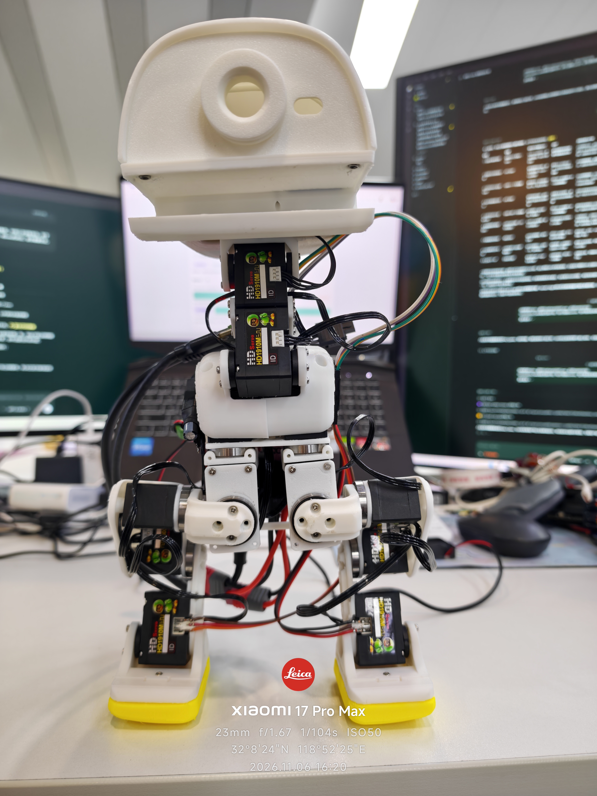
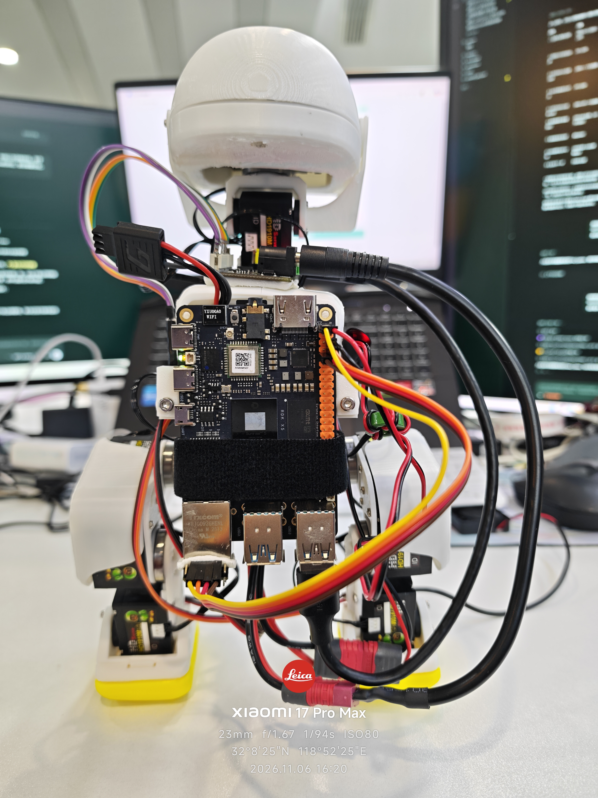

# 当前样机｜航模电池与外挂X5

更新：2026-11-06。**上一版2S航模电池＋5V UBEC供电方案验证成功，行走稳定性仍待验证。** 正在等待新采购的Hub和线束，本次不更新行走视频。

| 正面 | 背面 |
|---|---|
|  |  |

完整RDK X5开发板背部外挂，电池位于原背部位置并用绑带固定；微雪位于上部躯干，JY901S固定在X5网口附近。微雪可用USB/B档或UART/A档通信，软件选择必须与实物一致。当前头颈从右腿继续串接，下一版计划用Hub拆为左腿、右腿、头颈三支路。

- [11月6日进度与目标](../progress/2026-11-06/README.md)
- [下一版硬件BOM](NEXT_HARDWARE_BOM.md)：已采购待到货，未验收。
- [10月23日双电池历史视频](../progress/2026-10-23/README.md)：保留，不改写为当前配置成果。
- [2026 DDC／地瓜机器人黑客松前计划](../ROADMAP.md)：优先行走及互动拓展，外挂方案暂不推进翻跟头。

当前照片和文档更新不替换固定Release的控制程序、标定或制造资产。
