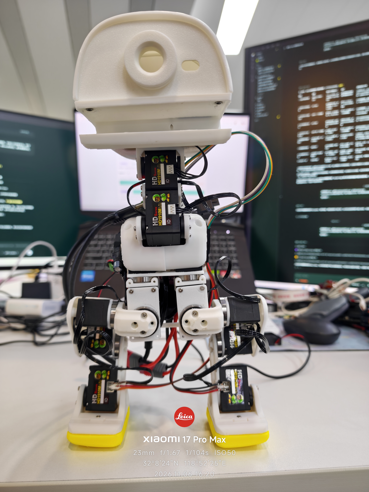
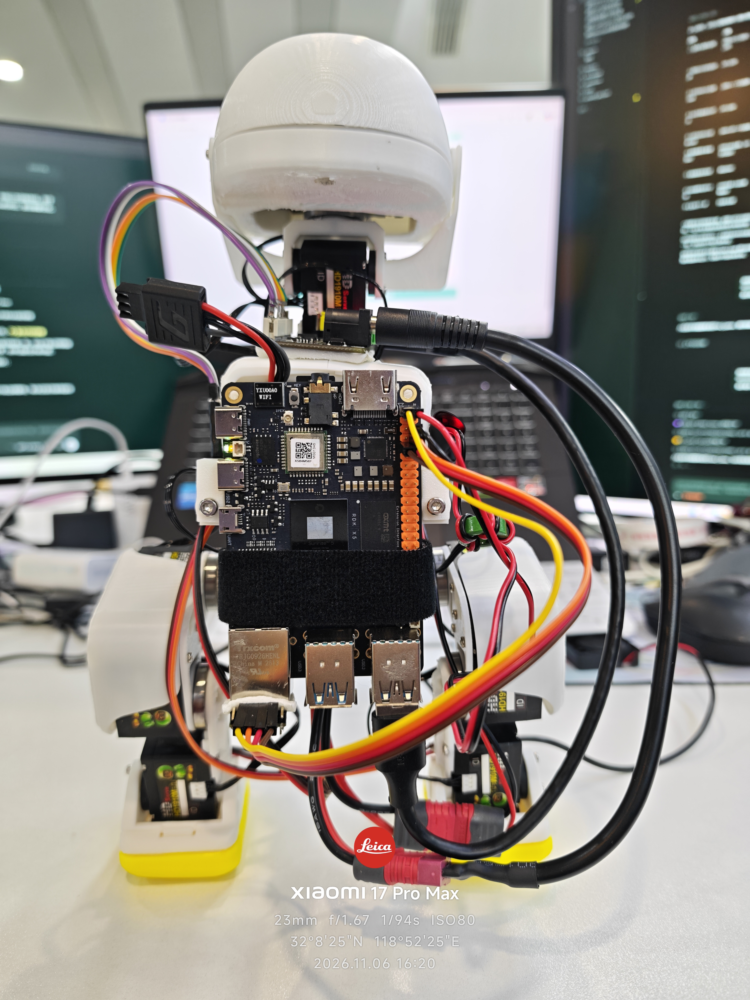

# 2026-11-06｜航模电池方案验证与下一版硬件准备

上一版 **2S 1000mAh 45C航模电池＋好盈5A UBEC（5.0V供X5）供电方案验证成功**。本次仅更新项目进度、样机照片和下一版硬件BOM，暂不更新行走视频。行走稳定性仍待验证，不把供电验证等同于长距离稳定行走完成。

## 当前样机

| 正面 | 背面 |
|---|---|
|  |  |

照片记录本轮外挂X5、电池及线束布局；下一版Hub与线束仍在等待到货，尚未安装验收。

## 下一步

保留现有RDK X5、微雪、HD1910M和IMU，加入成品Hub，将左腿、右腿和头颈分为三条支路，减少头颈经腿部串接。完成线束固定、供电和通信复核后，继续验证站姿、起步、换腿与收步。[下一版硬件BOM](../../docs/NEXT_HARDWARE_BOM.md)

## 项目目标

以 **2026-12-04** 为项目目标日期，争取在 **2026 DDC／地瓜机器人黑客松前** 完成行走演示及相关拓展：物品夹取、睡眠／唤醒站立、语音和视觉互动。上述为开发计划，不代表已经实现；优先完成基础行走展示。

由于 **RDK X5为外挂方案**，当前装载、固定和走线方式不适合直接照搬高动态动作，**暂不推进翻跟头等高冲击动作**。

## 交流

交流群已达200人，不再展示邀请二维码。希望进群交流，请联系[CanNyCat17](https://github.com/CanNyCat17)，由我邀请进群，可在仓库Issue或地瓜社区原帖留言。

此前视频和固定Release继续保留为历史成果，本次未替换视频或发布新的实机控制软件。
